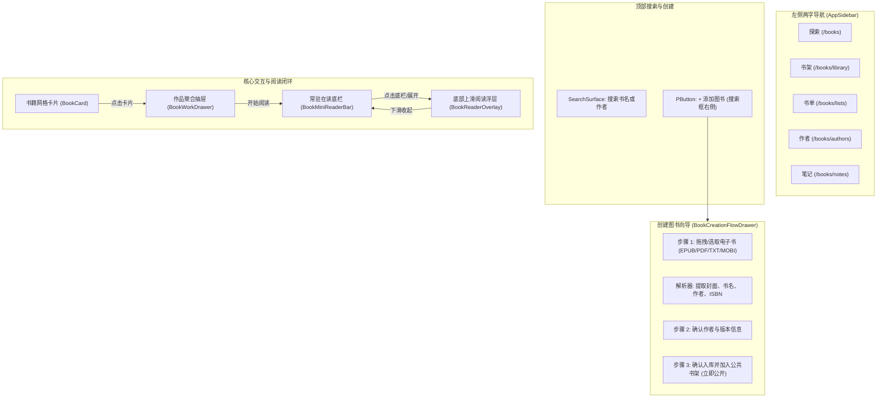

# 书籍模块 UI/UX 全面重构设计规格书 (Design Spec)

- **日期**：2026-10-13
- **模块**：`Atoman-Frontend` 书籍模块 (`src/views/books/`, `src/components/books/`)
- **对齐规范**：Pure-White Minimal System, `frontend-ui.md`, `design_system.md`, `AGENTS.md`
- **重构模式**：**方案 B（一次性全面整体换代）**

---

## 1. 重构背景与核心目标

当前书籍模块存在三大核心断层：
1. **创建流程断层**：新建电子书（上传 TXT/EPUB/PDF 等）目前走私有网盘资产通道，无法直接作为公共书籍在社区展示和流转；公共作品创建又被深埋在“治理/贡献”表单中，缺乏统一向导。
2. **交互体验断层**：页面缺乏像音乐模块那样沉浸、连贯的阅读底栏与抽屉体系；作品详情页冗长分散，缺少极简的一屏直达抽屉。
3. **视觉风格与规范断层**：存在非令牌颜色、旧式 8px/12px 圆角、字重过重（600/700）以及开发视角词汇。

**重构核心目标**：
- **纯白极简双缺口系统**：严格遵守 4px 圆角、纯白背景（`var(--a-color-bg)`）、柔和分割线（`var(--a-color-border-soft)`）与克制字重（标题 500 / 强调 600）。
- **统一公共创建向导**：参考音乐模块（`MusicCreationFlowDrawer.vue`），在搜索框右侧放置“+ 添加图书”，所有上传图书统一录入公共书目流，自动解析封面与元数据并支持在线阅读。
- **两字极简左侧导航**：探索 · 书架 · 书单 · 作者 · 笔记。
- **一屏直达聚合抽屉 (`BookWorkDrawer.vue`)**：点击书目卡片弹出右侧抽屉，聚合版本、格式、大纲、短评与快速阅读入口。
- **常驻在读底栏 (`BookMiniReaderBar.vue`)**：类比音乐播放底栏，常驻屏幕底部，展示当前在本书目封面、章节、百分比进度与沉浸阅读展开入口。
- **底部上滑阅读浮层**：在读底栏点击展开时，采用自底向上滑出的全屏/宽屏沉浸阅读浮层，下滑顺滑收起回底栏。

---

## 2. 架构设计与用户旅程

### 2.1 整体架构视图



---

## 3. 详细模块设计

### 3.1 导航结构（全部两字化）
在 `src/components/system/AppSidebar.vue` 中统一书籍子导航项：
- **探索** (`/books`)：精选推荐、热门作品、公共可以阅读正文流。
- **书架** (`/books/library`)：我的在读、想读、已读记录，个人同步进度。
- **书单** (`/books/lists`)：专题书单、分类导读合集。
- **作者** (`/books/authors`)：名家档案、作者索引与关联著作。
- **笔记** (`/books/notes`)：阅读批注、划线高亮、精选书评。

### 3.2 顶部操作与搜索布局（对齐音乐模块）
- 在探索页与各主视图顶部，采用统一的工具条布局：
  ```html
  <div class="books-toolbar-row">
    <SearchSurface
      v-model:query="searchQuery"
      placeholder="搜索书名或作者..."
      compact
    />
    <PButton variant="primary" @click="openBookCreationFlow">
      添加图书
    </PButton>
  </div>
  ```
- **位置**：按钮紧邻搜索栏右侧（如同音乐模块的“添加专辑”），视觉层级清晰。

### 3.3 图书创建流程：统一公开入库 (`BookCreationFlowDrawer.vue`)
- **原则**：用户不再区隔“私有上传 vs 治理公共”。只要上传电子书，均作为公共图书资产处理并直接入库，同时自动归入当前用户书架的“在读/拥有”。
- **步骤设计**：
  1. **步骤 1：上传与预解析 (Seed & Extract Step)**
     - 拖入或选取文件（支持 `.epub`, `.pdf`, `.txt`, `.mobi`, `.azw3`）。
     - 前端提取书籍元信息：提取封面图像 Blob、书名、作者、ISBN（EPUB 解析 `opf` 文件，PDF 解析 `documentInfo`）。
     - 自动比对已有库：若发现相同 ISBN 或书名，提示“检测到已存在该作品，是否作为新版本关联”。
  2. **步骤 2：作者与版本补充 (Author & Edition Step)**
     - 自动关联已有作者档案，或快速新建作者（仅需姓名/原名）。
     - 补充出版社、出版年份、语言、ISBN-13 等版本字段。
  3. **步骤 3：作品详情与公开阅读 (Details & Publish Step)**
     - 简介、分类标签确认。
     - 自动勾选“作为公共阅读正文发布”（所有人可在线翻阅）。
     - 实时预览生成的书籍封面、书脊与作品卡片。
     - 点击提交：完成上传与入库，自动提示“图书已发布至公共书库”，并提供“立即阅读”按钮。

### 3.4 一屏直达作品聚合抽屉 (`BookWorkDrawer.vue`)
- 替代跳转式繁杂页面，点击任何 `BookCard` 均在右侧呼出抽屉（宽度约 480px~540px，移动端自适应为底部抽屉）。
- **内容聚合**：
  - **头部身份区**：高清封面（4px 圆角）、书名、作者徽章、评分组件（`RatingControl`）。
  - **核心动作栏**：【开始阅读 / 继续阅读】（大按钮，`variant="primary"`）、【加入书架】（`PSelect` 或按钮）、【写短评】。
  - **版本与格式列表**：展示可用阅读版本（EPUB、PDF、TXT 等格式与文件大小）。
  - **目录大纲预览**：可折叠展开的章节目录树，点击某一章节可直接定位阅读。
  - **精选短评与讨论**：收敛的精选书评卡片，杜绝冗长堆砌。

### 3.5 常驻在读底栏 (`BookMiniReaderBar.vue`)
- **定位**：常驻于屏幕底部的 Mini Reader Bar，高度统一为 48px ~ 52px（类似音乐播放条，背景纯白 `var(--a-color-bg)`，顶边线 `1px solid var(--a-color-border-soft)`）。
- **组件结构**：
  - **左侧**：缩略封面（32x44px，4px 圆角）+ 书名与当前章节标题（文本单行省略截断）。
  - **中部**：迷你进度条与进度百分比（例如：“已读 42% · 第 12 章”）。
  - **右侧**：【继续阅读】动作按钮（或向上展开图标）、【加入书签】快捷动作。
- **响应式协同**：当音乐播放条同时激活时，Mini Reader Bar 具备协同吸附或叠层让位逻辑。

### 3.6 沉浸阅读器架构：参考 PDF Expert 专业级排版交互 (`BookReaderView.vue` / `BookReaderOverlay.vue`)

参考 **PDF Expert**（如图所示的专业级阅读器布局体系），将阅读器重构为标准的三栏/工具栏专业阅读架构：

```
+---------------------------------------------------------------------------------------------------------+
| [≡ 目录/缩略图] [114% ▾] [- +]  [A 字体/高亮/批注] [✎ 编辑] [Q 检索]                            [✕ 退出] | Top Navigation
+-------------------+---------------------------------------------------+---------------------------------+
| 📑 侧边导航栏      |                                                   | 🔍 右侧辅助检索栏 (可折叠)       |
| (可折叠：Thumbnails|              📄 核心文档视口 (Document Canvas)     |                                 |
| / 大纲目录 / 书签)|                                                   | • 检索结果高亮列表              |
|                   |   - 连续垂直滚动 / 双页模式                         | • 快速跳转定位                  |
| - 页面缩略图瀑布流 |   - 多级无级缩放 (Zoom Fit / Width / Actual)      | • 关键词上下文摘要              |
| - 当前页高亮标记   |   - 纯净原版纸张背景，微阴影与精致页面间隔        |                                 |
| - 尺寸/页码指示   |                                                   |                                 |
+-------------------+---------------------------------------------------+---------------------------------+
| [◀ 上一页] [第 6 / 24 页] [下一页 ▶]                     [阅读进度: 25%]  [☀️/🌙 护眼主题]                  | Bottom Status Bar
+---------------------------------------------------------------------------------------------------------+
```

#### 核心特征与交互对齐：
1. **左侧双模导览边栏 (Sidebar: Thumbnails & Outlines)**：
   - **缩略图瀑布流 (Thumbnails)**：直观展现 PDF/EPUB 每页微缩预览，标注当前页（蓝框选中态）、页码及尺寸比例（如 `A4 11.69 x 8.26 in`）。
   - **大纲目录 (Outline / TOC)**：折叠树形结构，实时跟随滚动高亮当前章节。
   - **书签列表 (Bookmarks)**：一键查看与跳转自定义书签。
2. **顶部悬浮/吸顶专业工具栏 (PDF Expert Floating Toolbar)**：
   - **视图与缩放**：缩放比例选择器（50%、75%、100%、125%、适合宽度、适合整页）、单页/双页/连续滚动切换。
   - **批注与划线 (Annotation)**：高亮笔（黄/绿/蓝/粉）、下划线、删除线、自由画笔、便签批注。
   - **文本与样式**：字体放大/缩小、行距微调、衬线/非衬线字体切换。
3. **右侧精准检索侧栏 (Search & Match Sidebar)**：
   - 区别于传统粗糙搜索，右侧滑出全文检索面板（匹配项计数、当前页码、匹配短语上下文高亮）。
   - 点击任何搜索结果瞬时平滑滚动至正文对应位置并闪烁高亮。
4. **阅读视口纸张级质感 (Document Canvas)**：
   - 页面背景微调为经典纸张色（纯白 `#ffffff`、米黄护眼 `#fbf0d9`、夜间暗色 `#18181b`）。
   - 页面之间保有克制而优雅的分割间隙与柔和阴影，呈现原生桌面级 PDF 阅读质感。
5. **在读底栏与浮层的丝滑联动**：
   - 在底栏常驻时，点击一键全屏展开该专业阅读界面；点击顶部【收起】或向下滑动，瞬时收回底栏，缩放比与滚动阅读偏移量毫秒级无缝记忆。

---

## 4. UI 规范与视觉契约审查

所有新增及重构的书籍组件均严格遵守全站统一设计规范：
1. **纯白表面 (Pure-White Surfaces)**：卡片、抽屉面板、底栏背景必须使用 `var(--a-color-bg)` / `#ffffff`，严禁使用灰色底 `var(--a-color-surface)`。
2. **柔和分割线 (Dividers)**：内部分割使用 `var(--a-color-border-soft)`，外框使用 `var(--a-color-border)`。
3. **小圆角 (Border Radius)**：封面、按钮、输入框、卡片等一律使用 4px 圆角（`var(--a-radius-card)` / `var(--a-radius-control)`），严禁 999px 药丸圆角或 8px/12px 圆角。
4. **克制字重 (Font Weight)**：标题与主文案统一字重 `500`，高亮强调状态统一字重 `600`，绝不出现 `700`、`800` 或 `bold`。
5. **用户态文案 (Copy Rules)**：去除“治理”、“内部审核”、“凭证上传”、“UUID”等开发者视角词汇，文案聚焦在“添加图书”、“上传”、“开始阅读”、“加入书架”。
