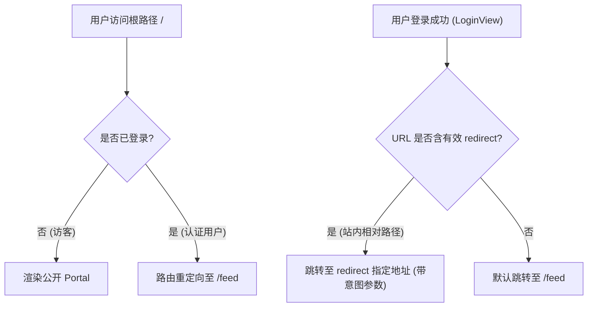
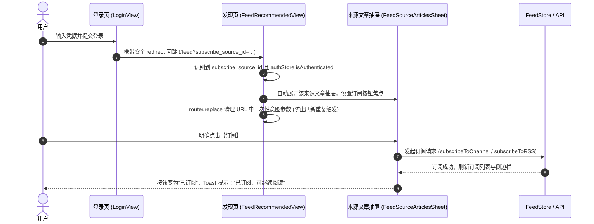

# Feed 首访到首读闭环设计规范 (Feed First Visit to Read Loop Design)

- **作者 / 负责人**：Antigravity & Product Owner
- **创建日期**：2026-10-15
- **状态**：Approved (已确认)
- **关联设计 / 规范**：
  - `Atoman-Frontend/docs/specs/2026-08-27-feed-core-loop-capability-map.md`
  - `Atoman-Frontend/docs/specs/2026-06-05-flat-paper-ui-design.md`
  - `Atoman-Frontend/.claude/rules/design_system.md`
  - `AGENTS.md` (文案与组件无阴影规范)

---

## 1. 背景与目标

### 1.1 业务背景
在当前的 Atoman 前端中，访客可以在未登录状态下访问 `/feed` 并浏览推荐文章和订阅源。然而，当访客希望进一步产生粘性动作（例如：订阅某个优质博客来源、收藏某篇长文、加入稍后阅读）时，流程存在中断痛点：
1. 访客点击“订阅”直接触发未认证报错或硬性跳转登录，丢失当前浏览位置与筛选上下文；
2. 登录完成后无明确重定向或直接跳回主站门户 `/`，未能恢复刚才希望订阅的来源抽屉；
3. 访客在文章阅读抽屉中点击“收藏”或“稍后阅读”缺乏友好的登录回跳指引。

### 1.2 核心目标
建立一条平滑、安全、无状态且无感知的**“首访到首读”**核心闭环：
$$\text{发现文章/来源} \longrightarrow \text{打开抽屉详情} \longrightarrow \text{安全携带意图跳转登录} \longrightarrow \text{登录成功自动恢复抽屉与焦点} \longrightarrow \text{明确确认订阅/收藏} \longrightarrow \text{连续阅读}$$

---

## 2. 详细技术方案

### 2.1 路由守卫与重定向策略

#### 2.1.1 根路径访问守卫 (`/`)
- **未登录访客**：展示公开聚合 Portal 页面，呈现平台全景内容。
- **已登录用户**：全局路由守卫直接重定向至日常信息流 `/feed`。

#### 2.1.2 默认登录成功跳转 (`LoginView.vue`)
- **无 `redirect` 参数**：默认跳转路径由 `/` 更改为 `/feed`。
- **有 `redirect` 参数**：通过 `resolveSafeRedirect(route.query.redirect)` 进行严格的站内相对路径校验（必须以 `/` 开头且非 `//`），防范开放重定向攻击。



---

### 2.2 意图编码与参数契约

当未登录访客触发受限动作时，系统不使用易丢失的内存状态，而是将意图安全编码在重定向 URL 的 Query 参数中，格式如下：

#### 2.2.1 来源订阅意图
- `subscribe_source_id`：目标订阅源/频道唯一标识 ID。
- `subscribe_source_type`：`internal_channel` | `external_rss`。
- `subscribe_source_title`：订阅源名称（用于推荐列表未命中时的兜底展示）。
- `subscribe_source_url`：（可选）RSS 源地址。
- **保留上下文**：原页面所有的过滤与分类参数（`category`、`theme`、`mode`、`scope`）保持不变。

#### 2.2.2 文章动作意图
- `read_article_id`：目标文章 ID。
- `article_action`：`star`（收藏）| `read_later`（稍后读）。

#### 2.2.3 安全跳转构造示例
```ts
const returnPath = router.resolve({
  path: route.path || '/feed',
  query: {
    ...route.query,
    subscribe_source_id: source.id,
    subscribe_source_type: source.type,
    subscribe_source_title: source.title,
    ...(source.rssUrl ? { subscribe_source_url: source.rssUrl } : {})
  },
  hash: route.hash,
}).fullPath

void router.push({ path: '/login', query: { redirect: returnPath } })
```

---

### 2.3 意图解析与抽屉状态机

#### 2.3.1 状态恢复流程



#### 2.3.2 离屏/外部来源构造兜底
当回跳返回 `/feed` 时，如果当前分页尚未加载该来源项：
- 系统读取 URL 中的 `subscribe_source_title`、`subscribe_source_type` 和 `subscribe_source_url`；
- 构造轻量来源实体并拉取来源文章列表展示，不发生抽屉吞没或空白闪烁。

#### 2.3.3 防重复与防副作用规则
- **显式确认原则**：登录回跳后**绝对不自动发起**网络写请求（POST /subscribe），仅恢复展示界面并聚焦按钮，必须由用户再次主动点击。
- **幂等性保障**：使用 `pendingIntentRestored` 标志位确保同一会话生命周期只恢复一次；恢复完成后立即调用 `router.replace` 剔除意图参数。

---

### 2.4 交互反馈与视觉规范

依据《全白双刻痕极简风设计系统规范》与文案简明原则：
1. **文案规范**：
   - 订阅中：`处理中...`（按钮禁用）
   - 订阅成功：`已订阅，可继续阅读`（极简 Toast，`aria-live="polite"`）
   - 订阅失败：`订阅失败，请重试`
   - 按钮状态流转：`+ 订阅` $\longrightarrow$ `处理中...` $\longrightarrow$ `已订阅`
2. **移动端响应式 (< 768px)**：
   - 抽屉自动降级为底部展开（Bottom Sheet），关闭与操作热区保证 $\ge 44\text{px}$。
   - 避开底部 4-Tab 导航栏，层级规整无抖动。

---

## 3. 验收标准与测试矩阵

### 3.1 自动化测试矩阵
- **路由测试**：
  - 未登录访问 `/` 渲染公开 Portal；已登录访问 `/` 重定向至 `/feed`。
  - `LoginView` 默认登录成功跳转到 `/feed`；非法/跨站 `redirect` 被强制重置为 `/feed`。
- **意图恢复测试 (`FeedRecommendedView.spec.ts`)**：
  - 访客点击来源卡片上的订阅按钮，携带完整 `subscribe_source_*` 参数跳转登录。
  - 携带 `subscribe_source_id` 参数进入已认证状态时，自动弹出对应来源抽屉。
  - 抽屉恢复后，URL 自动清理意图参数但保留过滤条件。
  - 用户点击抽屉订阅按钮后成功订阅，Toast 提示“已订阅，可继续阅读”，且不重复触发请求。
- **文章抽屉测试 (`FeedArticleSheet.spec.ts`)**：
  - 访客在文章阅读抽屉点击“收藏”或“稍后阅读”触发登录意图带参跳转。
  - 登录后恢复打开该文章抽屉。

### 3.2 检查命令
```bash
bun run type-check
bun run test:unit tests/unit/views/feed/FeedRecommendedView.spec.ts
bun run test:unit tests/unit/views/auth/LoginView.spec.ts
bun run test:unit tests/unit/components/feed/FeedArticleSheet.spec.ts
bun run test:unit tests/unit/router/routes.spec.ts
bun run build
```
