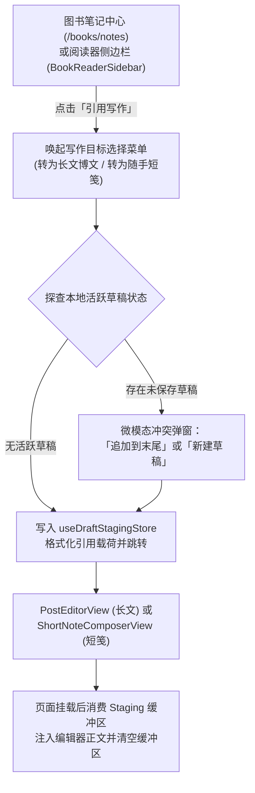

# Reading Notes to Writing Loop Design Spec

## Executive Summary

本文档定义了将 Atoman 图书划线摘录与个人笔记（Reading Notes）直接流转至写作中心（Studio Post Editor & Short Notes）的端到端设计规范。通过引入轻量且解耦的会话级草稿中转层（`useDraftStagingStore`），用户可在全书笔记中心（`/books/notes`）以及图书阅读器侧边栏（`BookReaderSidebar`）中，一键将书摘与感悟导入为「长文博文」或「随手短笺」，打通“阅读输入 ➔ 写作输出”闭环。

---

## Architecture & Data Flow



### 1. 核心状态层 (`useDraftStagingStore`)
位于 `src/stores/draftStaging.ts`：

```typescript
export interface BookQuotePayload {
  sourceType: 'book_annotation'
  annotationId: string
  assetId: string
  bookTitle: string
  bookAuthor?: string
  quoteText: string
  personalNote?: string
  target: 'blog_post' | 'short_note'
  mode: 'append' | 'replace'
}

export function formatBookQuoteCitation(
  payload: Pick<BookQuotePayload, 'quoteText' | 'bookTitle' | 'bookAuthor' | 'personalNote' | 'target'>
): string
```

### 2. 格式化规范
- **长文博文（Markdown 格式）**：
  ```markdown
  > {quoteText}
  > ——《{bookTitle}》{bookAuthor ? ` · ${bookAuthor}` : ''}

  {personalNote ? `${personalNote}\n` : ''}
  ```
- **随手短笺（Markdown / Plain 格式）**：
  ```markdown
  {personalNote ? `${personalNote}\n\n` : ''}「{quoteText}」——《{bookTitle}》
  ```

---

## UI & Interaction Specifications

严格遵循《纯白双刻痕极简风设计系统规范》：
- 背景表面：纯白 `#FFFFFF` / `var(--a-color-bg)`
- 控制圆角：4px (`var(--a-radius-control)`)
- 阴影与边线：`var(--a-shadow-dropdown)`，`var(--a-color-border-soft)`
- 字重：500 / 600

### 1. 入口与触发按钮
在 `BookNotesView.vue` 和 `BookReaderSidebar.vue` 的卡片操作区，新增「引用写作」按钮：
- 图标：`PenTool` (from `lucide-vue-next`)
- 尺寸：13px，按钮 `variant="ghost"`，`size="sm"`
- 点击弹出轻量纯白浮层 `QuoteTargetMenu`。

### 2. 轻量目标选项浮层 (`QuoteTargetMenu`)
- **转为长文博文**：图标 `FileText`，说明“进入 Studio 撰写长评或专栏文章”。
- **转为随手短笺**：图标 `MessageSquare`，说明“快速发布轻量阅读随笔”。

### 3. 草稿冲突确认模态框 (`DraftConflictModal`)
当转为长文且当前存在未发布的活跃草稿时触发：
- 标题：`检测到已有博文草稿`
- 描述：`您有一篇正在编辑的草稿，请选择如何处理书摘引用：`
- 操作按钮：
  - `追加到末尾`（推荐，保留现有正文，末尾追加引用段落）
  - `新建草稿`（重置为新草稿，填入书摘引用）
  - `取消`

---

## Editor Ingestion

### 1. 长文博文 (`PostEditorView.vue`)
- 在编辑器就绪后（`contentReady`）：
  - 若 `mode === 'append'`：正文追加 `\n\n${formattedQuote}`。
  - 若 `mode === 'replace'`：正文填入 `formattedQuote`，若标题为空则建议为 `《${bookTitle}》读后感`。
  - 触发自动保存流程，并清空 `pendingPayload`。

### 2. 随手短笺 (`ShortNoteComposerView.vue`)
- 在进入路由 `/posts/notes/new` 时：
  - 检测到短笺载荷，初始化 `ShortNoteComposer` 的 `initialContent`。
  - 清空 `pendingPayload`。

---

## Verification & Testing Matrix

1. **单元测试 (`tests/unit/stores/draftStaging.spec.ts`)**：
   - 验证载荷设置、消费、清除。
   - 验证长文与短笺格式化模版输出（包含与不包含个人想法、包含与不包含作者）。
2. **组件测试 (`tests/unit/views/books/BookNotesView.spec.ts` & `BookReaderSidebar.spec.ts`)**：
   - 验证「引用写作」按钮渲染。
   - 验证点击「转为博文」与「转为短笺」能够成功写入 Staging 并触发对应跳转。
3. **编辑器承接测试 (`tests/unit/views/blog/PostEditorView.spec.ts` & `ShortNoteComposerView.spec.ts`)**：
   - 验证草稿存在时的追加行为与不存在草稿时的预填行为。
