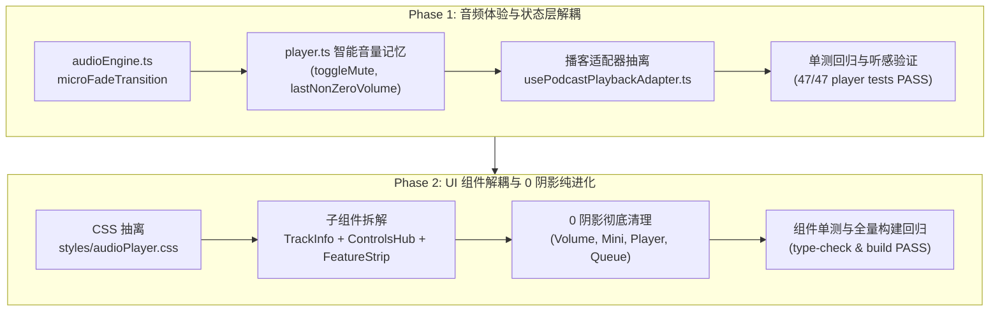

# 音乐播放器音频体验提升与架构拆解重构设计规范 (Design Spec)

- **日期**: 2026-10-19
- **状态**: 待执行
- **模块**: `Atoman-Frontend` / 音乐播放器子系统 (`player.ts`, `AudioPlayer.vue`, `audioEngine.ts`)

---

## 1. 背景与目标

在前期迭代中，我们修复了音乐播放器进度条点击快进二次发声（double seek）、播放头回弹跳跃、二次方音量曲线不一致等问题。当前播放器在核心听感、领域状态架构和 UI 组件实现上仍存在技术债务：
1. **切歌硬件爆音（DC Offset Pop Artifact）**：当音频在播放中被快速切换或重新赋值 `player.src` 时，波形非零交点直接被截断，在耳机或高保真扬声器中会产生细微的“咔哒”数字瞬态爆音。
2. **音量记忆丢失**：用户自定义音量（如 0.85）在点击静音后，解除静音时被硬编码还原为 0.5，未能记住用户的实际偏好。
3. **`player.ts` 庞大且多领域耦合**：核心播放器 Store（1409 行）中硬编码了约 250 行播客（Podcast）专属逻辑（进度持久化、单集格式转换、生命周期埋点上报），应将其解耦为外部适配器，使播放器内核保持轻量与专注。
4. **`AudioPlayer.vue` 巨型单体组件（1728 行）与样式冗余**：包含了 1170 行 Scoped CSS，且内部聚合了曲目信息、控制中心、进度条和功能抽屉触发器。
5. **残留阴影违背设计规范**：`AudioPlayer.vue`、`AudioPlayerVolume.vue`、`AudioPlayerMini.vue` 等组件多处使用 `box-shadow`，违背仓库《严格 0 阴影：`box-shadow: none !important;`》的全局纸张设计系统规范。

---

## 2. 总体设计原则

1. **听感优先与零回退**：切歌、切流必须平滑无杂音；现有全部 47 项 `player.spec.ts` 单元测试与播放器组件单测 100% 保持通过。
2. **向后完全兼容**：`usePlayerStore` 对外导出的所有 state / getter / action 签名保持 100% 兼容，不得破坏任何现有调用方（如播客、信息流、曲库）。
3. **分层清晰与高内聚**：
   - 底层音频控制：`src/utils/audioEngine.ts`（无 UI 依赖、易于单测）。
   - 领域适配：`src/composables/usePodcastPlaybackAdapter.ts`（播客特定进度与埋点）。
   - 状态协调：`src/stores/player.ts`（通用音频流调度中心）。
   - 视图表现：`src/components/music/AudioPlayer.vue` 拆分为聚焦的子组件。
4. **严格遵循设计系统规范**：
   - 严格 0 阴影：`box-shadow: none !important;`。
   - 严格 4px 圆角：`border-radius: 4px;`。
   - 纯白纸张基底：`#FFFFFF` 纸张底色与 `1px solid var(--a-color-border-soft)` 发丝线分割。

---

## 3. 分阶段架构设计

本重构采用两阶段递进式推进：



---

## 4. Phase 1 详细设计

### 4.1 切歌微淡出防爆音 (`audioEngine.ts` & `player.ts`)
- **微淡出算法**：
  在 `src/utils/audioEngine.ts` 中增加 `transitionAudioSource(audio: HTMLAudioElement, nextUrl: string, prepareNext: () => void, durationMs = 35): Promise<void>`：
  - 如果音频处于播放状态且 `audio.currentTime > 0`：
    在 `35ms` 内（分为 3~4 个 step）将音量渐降为 0，调用 `audio.pause()`，再调用 `prepareNext()` 赋新源，最后将音量重置回用户设定的实际音量。
  - 在 JSDOM / Node 单元测试环境或没有实际播放时，若 `audio.paused` 为 true，立刻同步执行 `prepareNext()`，避免异步挂起导致单测变慢或超时。
- **Store 协同**：
  在 `player.ts` 的 `startSong` 和重置音频源时，使用该微淡出策略安全换源，杜绝硬件 DC Offset 咔嗒声。

### 4.2 智能音量记忆与 Mute 控制 (`player.ts`)
- **状态维护**：
  - 增加 `lastNonZeroVolume = ref(1.0)`。
  - 初始化时，如果从本地存储恢复的音量大于 0，则同步给 `lastNonZeroVolume`。
  - 在 `setVolume(v)` 时：若 `v > 0`，更新 `lastNonZeroVolume.value = v`。
- **Action & Getter**：
  - `toggleMute()`：
    ```ts
    const toggleMute = () => {
      if (volume.value > 0) {
        lastNonZeroVolume.value = volume.value;
        setVolume(0);
      } else {
        setVolume(lastNonZeroVolume.value > 0 ? lastNonZeroVolume.value : 0.5);
      }
    };
    ```
  - `isMuted = computed(() => volume.value === 0)`。
- **UI 绑定统一**：
  - 将 `AudioPlayer.vue` 中的 `@toggle-mute="player.setVolume(player.volume > 0 ? 0 : 0.5)"` 改为 `@toggle-mute="player.toggleMute()"`。
  - 全局快捷键 `M` 统一调用 `player.toggleMute()`。

### 4.3 播客适配器解耦 (`src/composables/usePodcastPlaybackAdapter.ts`)
- **抽离内容**：
  - `readPodcastProgress(episodeId: string)` 与 `savePodcastProgress()` 本地进度管理。
  - `createPodcastSong(item: FeedItem)` 与 `createPodcastEpisodeSong(episode: PodcastEpisode)` 模型转换函数。
  - `createPodcastConsumptionTracker` 实例及进度生命周期上报。
- **兼容策略**：
  - `player.ts` 将相关逻辑委托给适配器，同时保留原 action 代理导出，所有现存调用方与单测保持 100% 正常工作。

---

## 5. Phase 2 详细设计

### 5.1 CSS 样式解耦
- 创建 `src/components/music/styles/audioPlayer.css`，将原 `AudioPlayer.vue` 中 1170 行 CSS 中的基础布局、浮动条外壳、折叠动画、响应式断点统一抽离。
- `AudioPlayer.vue` 中仅保留极简的基础样式引入。

### 5.2 子组件拆解
将 `AudioPlayer.vue` 拆分为 3 个纯净高内聚子组件：
1. **`src/components/music/player/AudioPlayerTrackInfo.vue`**：
   - 职责：封面渲染（含 Fallback）、歌曲标题、艺术家与专辑外链跳转、最爱（Favorite）切换按钮、歌单 Popover、播客专用收藏/稍后听按钮。
   - Props / Emits：清晰定义，解耦事件传递。
2. **`src/components/music/player/AudioPlayerControlsHub.vue`**：
   - 职责：上一首、播放/暂停、下一首、播客快进快退 15 秒、播放模式切换（循环/单曲/随机）。
3. **`src/components/music/player/AudioPlayerFeatureStrip.vue`**：
   - 职责：歌词/节目说明切换、评论抽屉唤起、音量控制器（`AudioPlayerVolume`）、播放队列抽屉唤起（`AudioPlayerQueue`）。
4. **容器组件 `AudioPlayer.vue`**：
   - 仅负责聚合上述 3 个子组件以及 `AudioWaveformProgress`、Mini 播放器、全屏歌词面板、评论侧边栏等抽屉，代码量大幅下降至 200~300 行内。

### 5.3 严格 0 阴影清理
- 全面检索并移除以下文件中的 `box-shadow`：
  - `src/components/music/AudioPlayer.vue`（及其子组件）
  - `src/components/music/AudioPlayerVolume.vue`（移除第 77、186、203 行的 `box-shadow`）
  - `src/components/music/AudioPlayerMini.vue`（移除第 83 行的 `box-shadow`）
  - `src/components/music/AudioPlayerQueue.vue`（移除残留 `box-shadow`）
- 统一替换为 `1px solid var(--a-color-border-soft)` 发丝线及实体纯白背景。

---

## 6. 验证计划与测试策略

1. **单元测试回归**：
   - `audioEngine.spec.ts`：增加对 `transitionAudioSource` 的单元测试。
   - `player.spec.ts`：全量 47 项单测保证 100% 通过，并追加 `toggleMute` 与 `lastNonZeroVolume` 记忆测试用例。
   - `AudioPlayer*.spec.ts`：所有现有组件单测保持全绿通过。
2. **类型与全量验证**：
   - `bun run type-check`：全项目 TypeScript 编译 0 错误。
   - `bun run test:unit`：跨模块单元测试全绿。
   - `bun run build`：Vite 生产构建成功。
