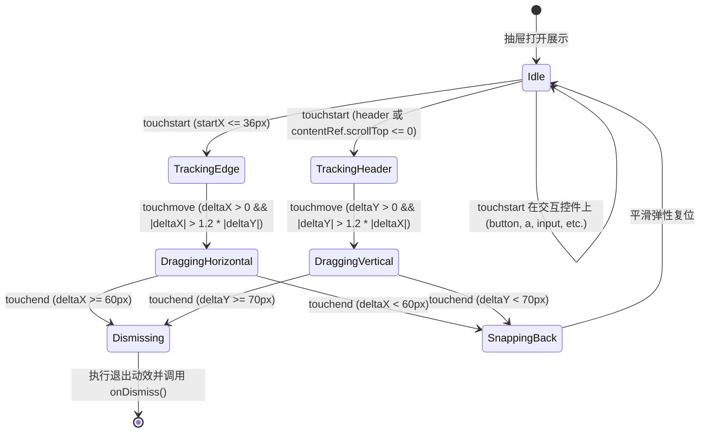

# 移动端 Web 曲库抽屉手势返回与 Mini 播放器吸底常驻设计规范

## 1. 背景与目标

### 1.1 背景
在 `apps/mobile/` 移动端 Web 应用中：
1. **抽屉关闭手势缺失**：曲库大抽屉（[`PSheet.vue`](file:///Users/fafa/projects/Atoman/Atoman-Frontend/src/components/ui/PSheet.vue) 渲染的专辑、艺术家、歌单抽屉）在移动设备上缺乏原生的触控返回手势。用户只能点击左上角的“返回”小按钮或点击背景遮罩，无法通过移动端常见的“屏幕左边缘向右推（iOS 边缘返回）”或“抽屉头部下拉返回”进行直觉退场。
2. **Mini 播放器在二级详情页消失**：[`MobileApp.vue`](file:///Users/fafa/projects/Atoman/Atoman-Frontend/apps/mobile/MobileApp.vue) 中 `showMobilePlayer` 强绑定了 `showMobileBottomNav.value`。当用户在听歌过程中点进单曲详情、专辑、书籍或博客等二级页面（底栏隐藏）时，底部的 Mini 播放器直接消失，打断了持续播放控制。
3. **Mini 播放器手势单一**：当前 [`MobileAudioPlayer.vue`](file:///Users/fafa/projects/Atoman/Atoman-Frontend/apps/mobile/MobileAudioPlayer.vue) 仅支持单点触发，缺乏向上滑动展开大播放器、左右横扫切歌等直觉手势。
4. **设计规范残留**：[`PSheet.vue`](file:///Users/fafa/projects/Atoman/Atoman-Frontend/src/components/ui/PSheet.vue) 中依然残留 `box-shadow` 样式，需要彻底贯彻 0 阴影规范。

### 1.2 目标
1. **打造自然流畅的抽屉退场手势**：
   - 支持**屏幕左边缘向右推**（`startX <= 36px`，向右滑移，模拟 iOS 原生返回体验）。
   - 支持**顶部头部下拉**（在抽屉标题栏或列表顶端向下滑移）。
   - 滑动中提供带阻尼的像素级视觉反馈，达到阈值平滑飞出并触发关闭，未达阈值平滑弹回复位。
2. **彻底解决长列表与交互冲突**：
   - 内部长列表滚动时（如曲目列表、歌词、评论），绝不拦截正常上下滚动；
   - 触摸交互元素（按钮、链接、输入框、标签控制）时不拦截正常点击；
   - 横向滚动控件（如 SegmentedControl 标签切换）不受右推返回手势干扰。
3. **Mini 播放器全局常驻与平滑吸底**：
   - 只要当前有曲目在播放且不在大播放器页，Mini 播放器在所有页面均常驻吸底；
   - 有底部导航栏时贴在导航栏上方（`bottom: calc(56px + env(safe-area-inset-bottom, 0px))`）；
   - 无底部导航栏时无缝下移贴底（`bottom: env(safe-area-inset-bottom, 0px)`），平滑过渡。
4. **Mini 播放器手势扩展**：
   - 向上滑动手势（`deltaY < -40px`）：打开全屏大播放器（`/music/player`）；
   - 左右轻扫手势（`|deltaX| > 50px`）：向左划切下一首，向右划切上一首。
5. **设计规范与安全区域合规**：
   - 清理所有非合规 `box-shadow`；
   - 正确适配 `env(safe-area-inset-bottom)` 与主内容区底部预留高度，确保内容不被遮挡。

---

## 2. 架构设计与模块划分

```
Atoman-Frontend/
├── src/
│   ├── composables/
│   │   └── useSheetGesture.ts         <-- [核心] 抽屉手势抽象逻辑（边缘右推、头部下拉、阻尼计算、平滑退出）
│   └── components/ui/
│       └── PSheet.vue                 <-- 接入 useSheetGesture；净化残留 box-shadow；适配移动端安全边距
└── apps/mobile/
    ├── MobileApp.vue                  <-- 解耦 Mini Player 与 BottomNav 判定，详情页常驻并动态计算吸底偏移
    └── MobileAudioPlayer.vue          <-- 增加触摸手势（向上滑展开全屏、左右滑切歌），自适应吸底样式
```

### 2.1 `useSheetGesture` 组合式函数契约

```ts
export interface UseSheetGestureOptions {
  /** 抽屉面板容器 ref */
  targetRef: Ref<HTMLElement | null>
  /** 抽屉头部标题栏 ref（用于下拉触发） */
  headerRef?: Ref<HTMLElement | null>
  /** 抽屉内容可滚动区域 ref（用于检查 scrollTop） */
  contentRef?: Ref<HTMLElement | null>
  /** 触发关闭回调 */
  onDismiss: () => void
  /** 是否启用手势（默认仅在移动端启用） */
  enabled?: MaybeRefOrGetter<boolean>
  /** 边缘判定区域宽度（px，默认 36） */
  edgeThreshold?: number
  /** 右滑关闭触发阈值（px，默认 60） */
  dismissThresholdX?: number
  /** 下拉关闭触发阈值（px，默认 70） */
  dismissThresholdY?: number
}

export interface UseSheetGestureReturn {
  /** 绑定在面板上的实时样式（transform / transition） */
  dragStyle: ComputedRef<CSSProperties>
  /** 是否正在处于手势拖拽中 */
  isDragging: Ref<boolean>
  /** 当前识别到的手势方向：'none' | 'horizontal' | 'vertical' */
  gestureDirection: Ref<'none' | 'horizontal' | 'vertical'>
}
```

---

## 3. 手势判定与状态机

### 3.1 状态转移



### 3.2 阻尼算法与跟手视觉反馈

当用户拖动面板时，位移采用对数阻尼衰减算法，避免面板被拉扯出界过大，保证手感扎实：
- 水平移动位移：`dx = deltaX <= dismissThresholdX ? deltaX : dismissThresholdX + (deltaX - dismissThresholdX) * 0.35`
- 垂直移动位移：`dy = deltaY <= dismissThresholdY ? deltaY : dismissThresholdY + (deltaY - dismissThresholdY) * 0.35`
- 拖拽进行中：`transition: none; transform: translate3d(dx, dy, 0);`
- 松手达到阈值：设置 `transition: transform 0.22s cubic-bezier(0.25, 1, 0.5, 1);`，滑向屏幕外侧，在 `transitionend`（或 220ms 定时器兜底）后执行 `onDismiss()`；
- 松手未达阈值：设置 `transition: transform 0.22s cubic-bezier(0.25, 1, 0.5, 1);`，复位至 `translate3d(0, 0, 0)`。

---

## 4. 边界情况与抗误触消解机制

1. **内嵌长列表（歌曲列表/歌词/评论）正常滚动保护**：
   - 下拉关闭手势严格限定在：
     - a) 触控起始点直接位于顶部标题栏 `.p-sheet-mobile-page__header`；
     - b) 内容区域处于绝对顶部（`contentRef.scrollTop <= 0`）且手指第一位移显著垂直向下。
   - 用户在曲目列表中间下拉滚屏时，`contentRef.scrollTop > 0`，手势直接让位给原生列表滚动，绝不触发关闭。
2. **横向滑动控件（SegmentedControl / 标签栏）冲突保护**：
   - 右推返回手势严格限制触摸起始点在屏幕最左边缘 `startX <= 36px`（模拟 iOS 边缘返回感应区），在屏幕中央或标签栏区域滑动绝不误触发返回。
3. **交互控件（按钮/播放键/收藏键）免打扰**：
   - `touchstart` 命中 `button, a, input, select, textarea, [data-interactive]` 时立即跳过手势捕捉，保证所有点击和次级操作 100% 灵敏响应。

---

## 5. Mini 播放器常驻吸底与手势规范

### 5.1 响应式吸底与过渡

在 [`MobileApp.vue`](file:///Users/fafa/projects/Atoman/Atoman-Frontend/apps/mobile/MobileApp.vue) 中：
- `showMobilePlayer` 判定更新为：
  ```ts
  const showMobilePlayer = computed(() => (
    playerPresence.hasCurrentTrack && route.path !== '/music/player'
  ))
  ```
- 动态注入 CSS 变量与类名：
  - 在存在底部导航栏时（一级模块）：`--mobile-app-player-bottom: calc(56px + env(safe-area-inset-bottom, 0px))`
  - 在无底部导航栏时（二级详情页）：`--mobile-app-player-bottom: env(safe-area-inset-bottom, 0px)`
- [`MobileAudioPlayer.vue`](file:///Users/fafa/projects/Atoman/Atoman-Frontend/apps/mobile/MobileAudioPlayer.vue) 样式调整为：
  ```css
  .mobile-mini-player {
    position: fixed;
    right: 0;
    bottom: var(--mobile-app-player-bottom, calc(56px + env(safe-area-inset-bottom, 0px)));
    left: 0;
    z-index: var(--a-z-player, 90);
    transition: bottom 0.2s ease;
  }
  ```
- 主内容区（`.mobile-app-main`）底部留白自适应：
  - 当 Mini 播放器挂载时，预留 `var(--mobile-app-player-height, 64px)` 的底部内边距，确保列表最后一项永远能完整滚动至播放器上方。

### 5.2 Mini 播放器触控手势

在 [`MobileAudioPlayer.vue`](file:///Users/fafa/projects/Atoman/Atoman-Frontend/apps/mobile/MobileAudioPlayer.vue) 中为曲目信息区域绑定触摸监听：
- **向上滑动手势**：`deltaY < -40px` 且垂直主导 -> 触发 `openPlayer()` 展开全屏播放器页面。
- **向左划动手势**：`deltaX < -50px` 且水平主导 -> 触发 `player.playNext()` 切下一首。
- **向右划动手势**：`deltaX > 50px` 且水平主导 -> 触发 `player.playPrevious()` 切上一首。
- **正常单点**：依然保持点击打开全屏大播放器。

---

## 6. 测试与验证策略

1. **单元测试 (`tests/unit/composables/useSheetGesture.spec.ts`)**：
   - 边缘右推手势：`startX <= 36px` 且 `deltaX >= 60px` 触发关闭。
   - 非边缘触控：`startX = 100px` 即使右滑也不触发关闭。
   - 头部下拉手势：头部滑动 `deltaY >= 70px` 触发关闭。
   - 列表滚动中：`scrollTop = 200px` 下拉时不触发关闭，优先列表滚动。
   - 交互元素过滤：触摸点在按钮时不启动拖拽。
   - 未达阈值平滑弹回：松手后样式还原为原位。
2. **Mini 播放器测试 (`tests/unit/mobile/music-views.spec.ts` & `navigation-shell.spec.ts`)**：
   - 验证 Mini Player 在无底部导航栏时保持挂载并使用正确吸底变量。
   - 验证 Mini Player 触摸手势事件（向左滑切下一首、向右滑切上一首、向上滑展开大播放器）。
3. **设计规范合规检查**：
   - 检查 `PSheet.vue`，彻底消除所有残留的 `box-shadow`。
4. **全量构建与回归**：
   - `bun run test:unit tests/unit/mobile/ tests/unit/components/ui/`
   - `bun run type-check`
   - `bun run build`
