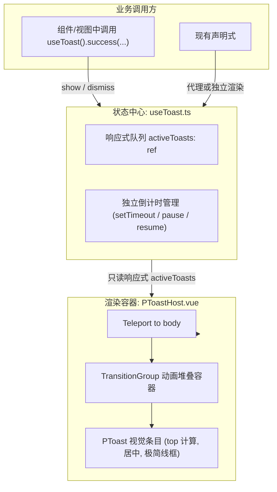

# 全站异步轻量操作反馈（Toast / 通知）统一治理系统设计

- **日期**: 2026-10-27
- **状态**: Approved
- **范围**: 前端全局与组件级轻量即时操作反馈机制规范与落地

---

## 1. 背景与现状

当前前端在处理即时、轻量的用户交互操作（如复制剪贴板、收藏/取消收藏、草稿暂存、删除成功等）时，存在以下问题：
1. **反馈缺失**：部分核心用户交互（如读书笔记引用复制、划线复制、私信消息复制）在成功执行 `navigator.clipboard.writeText` 后，缺乏任何可见视觉反馈，用户无法确认是否复制成功；
2. **样式与交互不一**：部分页面（如 `StudioContentView.vue`）使用推挤正文布局流的内联 `<p class="studio-content__feedback">` 提示操作结果，部分组件使用 ad-hoc 的临时按钮文字切换；
3. **样板代码冗余**：现有声明式 `<PToast>` 组件需要在每个使用组件的 `<template>` 里重复挂载，并在 `<script setup>` 中维护 `const toastVisible = ref(false)`、`const toastMessage = ref('')` 等状态；
4. **堆叠逻辑隔离**：原有 `PToast.vue` 内部的 `activeToastTokens` 位于组件独立的 `<script setup>` 作用域内，多实例同时触发时无法感知彼此位置，容易发生重叠。

---

## 2. 架构设计与目标

### 2.1 设计目标
1. **全局命令式调用**：提供简洁且类型友好的 `useToast()` 组合式函数，一行代码即可触发全局提示；
2. **纵向平滑堆叠**：支持并发最多 3 条 Toast 垂直堆叠（超出自动 FIFO 移除最早一条），单条独立计时 1800ms 自动淡出，悬停暂停计时；
3. **100% 向后兼容**：保留现有声明式 `<PToast v-model="visible" :message="msg" />` 用法，确保已有组件与单测不受影响；
4. **设计规范契约**：严格遵循 0 阴影/极简线框、4px 圆角、无毛玻璃背景混合规范，统一使用标准设计 token（如 `var(--a-z-toast, 900)`）。

### 2.2 核心模块分工



---

## 3. 详细设计

### 3.1 状态与 API 契约 (`src/composables/useToast.ts`)

```ts
export type ToastType = 'success' | 'warning' | 'danger' | 'error' | 'info'

export interface ToastOptions {
  id?: string
  message: string
  title?: string
  type?: ToastType
  duration?: number // 默认 1800ms，为 0 时不自动销毁
}

export interface ToastItem {
  id: string
  message: string
  title: string
  type: ToastType
  duration: number
  createdAt: number
}
```

对外暴露的组合式 API：
- `useToast().show(options: ToastOptions | string): string`
- `useToast().success(message: string, options?: Partial<ToastOptions>): string`
- `useToast().error(message: string, options?: Partial<ToastOptions>): string`
- `useToast().warning(message: string, options?: Partial<ToastOptions>): string`
- `useToast().info(message: string, options?: Partial<ToastOptions>): string`
- `useToast().dismiss(id: string): void`
- `useToast().clear(): void`
- `useToast().toasts: Readonly<Ref<ToastItem[]>>`

队列规则：
- 最大容纳条数：`MAX_CONCURRENT_TOASTS = 3`；
- 超出上限时，平滑截断移除最前一条（FIFO）；
- 倒计时机制：为每个条目保存 timer，鼠标 `mouseenter` 暂停计时，`mouseleave` 恢复剩余时间。

### 3.2 容器与视觉契约 (`src/components/ui/PToastHost.vue`)

- **挂载点**：桌面端 `src/App.vue` 与移动端 `apps/mobile/MobileApp.vue` 根节点；
- **渲染位置**：通过 `<Teleport to="body">` 渲染；
- **视觉层级**：`z-index: var(--a-z-toast, 900)`；
- **堆叠坐标**：
  `top: calc(var(--a-topbar-height, 56px) + max(1rem, env(safe-area-inset-top, 0px)) + ${index * 52}px)`；
- **水平居中**：`left: 50%; transform: translateX(-50%);`；
- **过渡动画**：`<TransitionGroup name="p-toast-slide">`，实现淡入和微位移平滑进入，淡出离开；
- **视觉特征**：
  - 严格 0 阴影；
  - 边框 `1px solid var(--a-color-border)`；
  - 背景 `var(--a-color-bg)`；
  - 圆角 `var(--a-radius-none, 4px)`；
  - 状态点指示器（点颜色对应 success / error / warning / info）。

---

## 4. 治理与改造清单

1. **零反馈点位补齐**：
   - `src/views/books/BookNotesView.vue`：`copyCitation` 补齐 `toast.success('引用已复制')`；
   - `src/components/books/BookPrivateHighlights.vue`：`copyText` 补齐 `toast.success('文本已复制')`；
   - `src/components/dm/DMConversationPane.vue`：`copyMessage` 补齐 `toast.success('消息已复制')`；
   - 剪贴板异常处理：统一捕获并在失败时提示 `toast.error('复制失败，请手动选中复制')`。
2. **现有反馈机制体验提升**：
   - `src/views/studio/StudioContentView.vue`：优化分享复制反馈，消除推挤页面流的局域提示；
   - 保持原有特调顶栏控件等桌面端定制设计百分百不动。

---

## 5. 测试与质量保证

1. **单元测试**：
   - `tests/unit/composables/useToast.spec.ts`：覆盖所有方法、队列截断、倒计时、暂停/恢复、手动销毁等状态边界；
   - `tests/unit/components/PToastHost.spec.ts`：覆盖容器渲染、堆叠样式、事件交互。
2. **全站回归验证**：
   - `bun run type-check`：严格 0 错误；
   - `bun run test:unit`：549 个套件、3,688 项测试保持 100% 通过；
   - `bun run build` & `bun run build:mobile`：双端构建正常。
